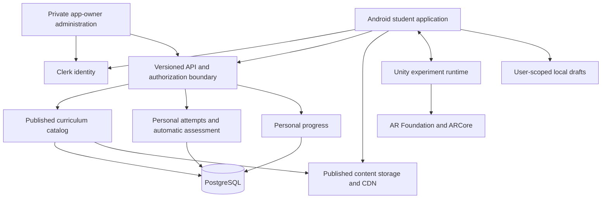
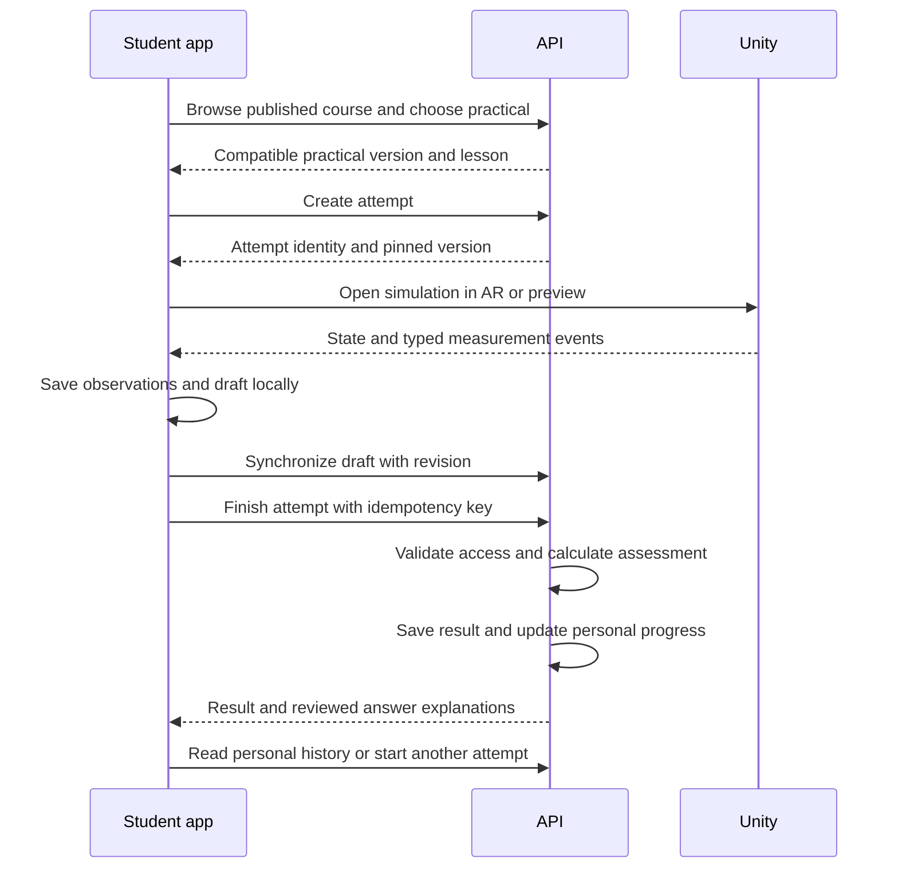

# PhyXara — Independent Learning App Architecture

Version: 1.1 | Date: 2026-11-10 | Status: Proposed independent application architecture

Related: [PRD](PRD.md), [TRD](TRD.md), [Roadmap](ROADMAP.md).

## 1. Architectural intent

One independently operated application serves individual students from any school or college, with university content added later. The app owner manages the reviewed catalog, application configuration, and publication. Students own their personal study history. Educational institutions have no administrative or content-editing authority.

Start with a modular backend, a PostgreSQL database, and a private owner administration interface. The core boundaries are published content, individual learning records, and internal administration. There is no institution tenancy, membership, classroom, or assignment subsystem.

## 2. System components

Owner administration and the API share a Next.js codebase initially. Domain services contain authorization and business logic; UI handlers must not duplicate that logic. The native app and Unity communicate locally using the versioned protocol described in the TRD. Only the app owner and explicitly authorized internal staff access the administration interface.

## 3. Personal ownership and owner control

Each student has one individual account. School, college, or university affiliation is not required. Education level and course selection are discovery preferences, not authorization roles.

For each private request:

1. Verify the identity token.
2. Derive the owning user from the verified session.
3. Check the requested operation; internal administration requires a separate owner-granted permission.
4. Load the private record through a user-scoped repository, checking ownership through its parent attempt where necessary.
5. Return only authorized data and record an audit event when appropriate.

All private relationships, caches, and queued operations preserve user ownership. UI filtering is not an access-control boundary. Catalog data follows a separate publication policy: students can read published content, while internal staff prepare reviewed revisions for owner publication.

Internal administration is a separate role boundary. No institution-admin or teacher-management role exists. Content-editing permission alone does not expose private student records. Neither an email domain nor a profile field can grant staff access.

## 4. Academic model across education levels

| Concept | School example | College example | Future university example |
|---|---|---|---|
| Curriculum framework | Board and edition | Board/qualification syllabus | Program curriculum |
| Course | Class 9 Physics | First-year Physics | Mechanics I |
| Module | Measurement chapter | Oscillations chapter | Rotational dynamics module |
| Optional catalog level label | Class 9 | First year | Introductory / semester label |
| Practical | Vernier measurement | Course practical | Laboratory exercise |

These are examples of catalog organization, not claims of available content. Educational level, grade labels, and course codes belong to owner-published catalog records. A course can reuse a practical, and a practical can reuse a simulation. Every student uses the same individual-account flow across these levels.

Future university content may add prerequisites and subject/semester labels when needed for learning navigation. It does not require department administration, institutional enrollment, university-managed accounts, or changes to personal-record ownership.

## 5. Experiment and self-assessment flow

Temporary network failure keeps a draft pending locally. Reauthentication as the same user or retry resumes synchronization. An attempt becomes complete only after server acknowledgment. Completion freezes the result; trying again creates a separate attempt. Retry requests return the existing completion result and do not duplicate progress. Automatic feedback comes from reviewed answer keys and tolerances, without requiring a teacher or an AI tutor.

## 6. Content production and expansion

Pipeline: source inventory → educator review → structured lesson → apparatus/model preparation → simulation implementation → image-target validation → assessment validation → publication.

Each published version retains source references, review status, simulation requirements, and assessment definitions. Treat source-book instructions as educational reference material, not operational instructions for development tools.

Release 1 bundles all 16 simulations and targets. Later content can reuse these engines without duplicating the application. Downloadable asset packs are a later optimization; new controller code still needs an application update.

Before university content launch, demonstrate one university course with modules, interactive practicals, self-assessment, and personal progress using the same account and learning-record architecture. The owner remains responsible for publishing its content.

## 7. Deployment and key decisions

- Deploy one web/API service per environment with a managed PostgreSQL database and object storage.
- Keep published assets separate from private learning records and administrative operations.
- Retain Clerk identity integration; record ownership and internal administration permissions remain server-enforced.
- Use AR Foundation/ARCore to align with the existing bridge implementation. Resolve the currently inconsistent Vuforia/AR Foundation dependencies before exporting.
- Keep Unity in a dedicated full-screen learning route and test camera/memory lifecycle on physical devices. See [Unity as a Library](https://unity.com/features/unity-as-a-library).
- Do not claim production compatibility of the existing native wrapper until Phase 0 verifies a reproducible Android build.
- Roll out schema/API changes compatibly, publish only content supported by installed clients, and keep previous published practical versions addressable for historical work.

## 8. Architecture acceptance

Students register directly and study without institutional approval. Two accounts have isolated learning records, including on a shared device. Students cannot invoke administrative publishing operations. New educational levels reuse the catalog and simulation engines, and a university course fits the same personal-account and result model. Institutions have no control over application changes or content publication.
